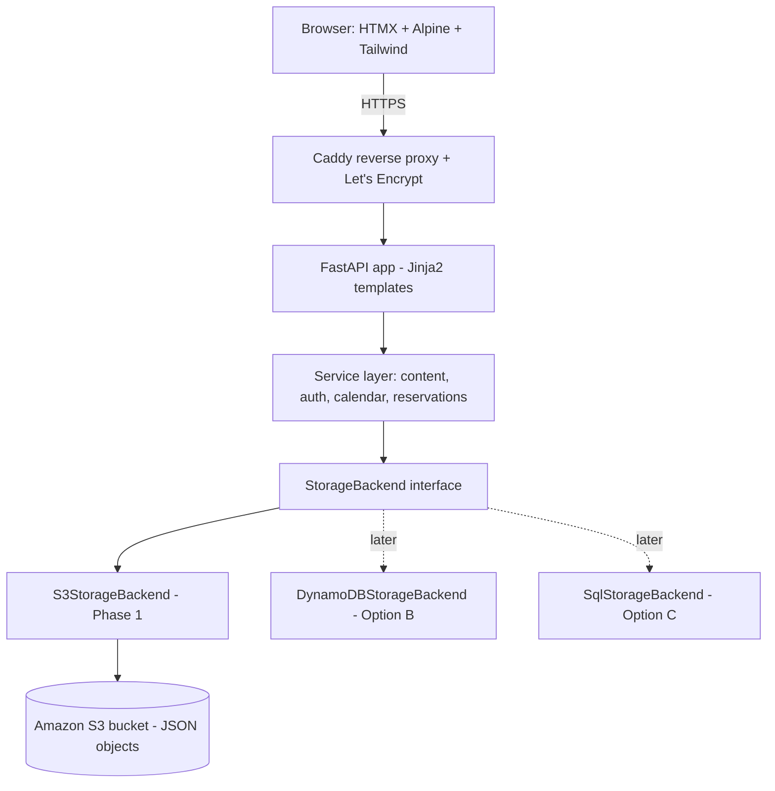

# Design — polskiprimal.pl Platform (Phase 1, Option A)

## Overview

A FastAPI application that renders server-side HTML (Jinja2) enhanced with HTMX and
Alpine.js, styled with Tailwind CSS. All persistence goes through a single abstract
`StorageBackend`; the only Phase 1 implementation is `S3StorageBackend`, which stores
JSON objects in Amazon S3. There is no relational database in Phase 1.

The design is driven by two goals from the steering spec:
1. **Ship early.** The content site (homepage, categories, blog) must run and be
   deployable before auth, calendar, and reservations are finished.
2. **No rewrite later.** Every feature depends on the `StorageBackend` interface, never on
   S3/boto3 directly, so Option B (DynamoDB for reservations) and Option C
   (PostgreSQL + SQLAlchemy + Alembic) drop in behind the same interface.



## Architecture

### Layers
- **Routers (FastAPI):** HTTP endpoints, request parsing, auth dependencies, template
  rendering / HTMX fragment responses. No storage logic here.
- **Services:** business logic (content lookup, category tree assembly, auth, calendar,
  reservations). Depend on the `StorageBackend` interface only.
- **StorageBackend:** abstract persistence boundary. Phase 1 = `S3StorageBackend`.
- **Models (Pydantic):** typed data shapes that serialize to/from JSON. The same shapes
  will map to DB tables in Option C, so field names are chosen to carry over.
- **Templates (Jinja2):** layout + pages + HTMX partials. Tailwind for styling; CSS
  variables for theme tokens.

### Why this stack
- Server-rendered Jinja2 + HTMX gives a reactive feel without a JS build pipeline, so the
  site loads fast and launches quickly (R1).
- Pydantic models give validation and a stable JSON contract that survives a future DB
  migration (R2).
- A thin service layer keeps routers testable and keeps S3 details out of features (R2).

### Configuration (`app/config.py`, pydantic-settings)
Read from environment / `.env`:
- `APP_ENV` (`dev` | `prod`), `SECRET_KEY`, `BASE_URL`
- `STORAGE_BACKEND` (default `s3`) — selects the backend implementation (R2.4)
- `S3_BUCKET`, `AWS_REGION`, `AWS_ACCESS_KEY_ID`, `AWS_SECRET_ACCESS_KEY`, optional
  `S3_ENDPOINT_URL` (for local MinIO in dev)
- Optional future: `DATABASE_URL`, payment keys — absent is allowed (R1.5)

The app must start even if payment/DB vars are missing (R1.5); only the storage vars for
the selected backend are required.

## Components and Interfaces

### StorageBackend (the key abstraction — R2)

```python
class NotFound(Exception): ...

class StorageBackend(ABC):
    @abstractmethod
    async def get_json(self, key: str) -> dict: ...        # raises NotFound (R2.5)

    @abstractmethod
    async def put_json(self, key: str, value: dict) -> None: ...

    @abstractmethod
    async def list(self, prefix: str) -> list[str]: ...    # returns object keys

    @abstractmethod
    async def delete(self, key: str) -> None: ...

    @abstractmethod
    async def try_reserve(self, slot_key: str, request: dict) -> ReserveResult: ...
```

- **`try_reserve` is the forward-compatibility seam (R8.4).**
  - Phase 1 (`S3StorageBackend`): appends a reservation-request object with status
    `requested` and returns `ReserveResult(ok=True, status="requested")`. It does **not**
    decrement quantity (R8.2) — no unsafe read-modify-write on shared stock.
  - Option B (`DynamoDBStorageBackend`): uses a conditional update / atomic counter to
    guarantee no oversell, returning `ok=False` if insufficient stock. Same signature.
  - Option C (`SqlStorageBackend`): does the same inside a transaction with row locking.
- Routers/services call `try_reserve`; they never know which backend answered (R2.2, R8.4).

`S3StorageBackend` uses `boto3` (via a thread executor or `aioboto3`). `get_json` maps a
missing key / `NoSuchKey` to `NotFound` (R2.5). A dev-only `LocalFsStorageBackend` or MinIO
via `S3_ENDPOINT_URL` lets the team run without real AWS.

### Service modules
- `content_service`: resolve category tree, list topics, load a topic/post, filter drafts (R3).
- `auth_service`: register, verify password (passlib/bcrypt), issue/verify JWT (R4).
- `calendar_service`: list/filter availability slots, assemble calendar view (R7); supplier
  CRUD on own slots (R6).
- `reservation_service`: create request via `try_reserve`, supplier confirm/decline (R8).
- `theme_service`: load theme JSON, expose tokens to templates (R9).

### Routers
- `public`: `/`, `/kategorie/...`, `/blog`, `/blog/{slug}`, `/kalendarz`, `/health` (R1, R3, R7, R10.6).
- `auth`: `/login`, `/register`, `/logout` (R4).
- `supplier`: `/panel` dashboard, slot create/edit/delete — guarded by `require_role("supplier")` (R5, R6).
- `admin`: `/admin` content/category/user/theme management, Verified Farmer toggle — `require_role("admin")` (R5, R6.5, R9).
- `reservations`: create request, supplier confirm/decline (R8).

### Auth & RBAC design (R4, R5)
- Passwords hashed with passlib bcrypt; never stored or logged in plaintext (R4.1).
- On login, issue a signed JWT (subject = user id, claim = role, short expiry) set in an
  HttpOnly cookie; Secure + SameSite=Lax when `APP_ENV=prod` (R4.2, R4.3).
- FastAPI dependencies: `current_user` (decode cookie) and `require_role(role)` factory;
  enforced server-side (R5.4). Unauthenticated access to protected routes → redirect to
  login or 401/403 (R5.1).
- Logout clears the cookie (R4.4). Invalid login returns a generic error (R4.5).

### Frontend / theming (R1.3, R9)
- Base Jinja2 layout injects theme CSS variables from `theme_service` into `:root`.
- Tailwind config maps semantic classes to those variables so changing the JSON theme
  restyles the site without code (R9.1–R9.3).
- Unfinished areas render a reusable "Wkrótce / Coming soon" partial instead of erroring
  (R1.3). A global 404 template handles missing content (R3.7).
- HTMX powers partial updates (calendar filters, reservation form submit) returning HTML
  fragments; Alpine handles light client state (menus, modals).

## Data Models (Pydantic → JSON in S3)

Field names chosen to map cleanly onto future DB tables (R2, Option C).

```python
Role = Literal["consumer", "supplier", "admin"]

class User(BaseModel):
    id: str                      # uuid
    email: EmailStr
    password_hash: str
    role: Role
    display_name: str
    verified_farmer: bool = False   # admin-controlled (R6.5)
    created_at: datetime

class Category(BaseModel):
    id: str
    slug: str
    title: str
    parent_id: str | None = None    # multi-level tree (R3.1)
    order: int = 0
    description_md: str = ""

class BlogPost(BaseModel):
    id: str
    slug: str
    title: str
    category_id: str | None = None
    body_md: str                    # Markdown (R3.3)
    author: str
    status: Literal["draft", "published"] = "draft"   # (R3.5)
    published_at: datetime | None = None

class AvailabilitySlot(BaseModel):
    id: str
    supplier_id: str
    product: str
    quantity: float
    unit: str                       # kg, szt, etc.
    market_location: str
    date: date
    time_start: time
    time_end: time
    price: float | None = None
    notes: str = ""
    verified_farmer: bool = False

class Reservation(BaseModel):
    id: str
    slot_id: str
    consumer_ref: str               # name/phone/email or user id
    quantity: float
    status: Literal["requested", "confirmed", "declined"] = "requested"
    created_at: datetime

class ThemeConfig(BaseModel):
    primary_color: str = "#2e7d32"
    accent_color: str = "#ff8f00"
    font_family: str = "Inter, system-ui, sans-serif"
```

### S3 key layout (object = JSON file)
```
users/{user_id}.json
users/_index_by_email.json           # email -> user_id lookup (no DB scan)
categories/{category_id}.json
categories/_index.json               # ordered id list for tree assembly
blog/{post_id}.json
blog/_index.json                     # id -> {slug,title,status,published_at}
calendar/slots/{slot_id}.json
calendar/index/{YYYY-MM}.json        # month -> slot ids (fast calendar reads, R7.4)
reservations/{slot_id}/{reservation_id}.json
config/theme.json
```
Small `_index` objects avoid expensive full-prefix listing for common reads and keep page
loads fast (R1, R7). Index updates are best-effort in Phase 1; this is acceptable because
reservations are request→confirm (no money/stock at risk) and becomes transactional under
Option B/C.

## Error Handling
- `NotFound` from the backend → 404 template for content routes (R3.7); never a 500.
- Auth failures → generic message, no field disclosure (R4.5); protected routes → redirect/403 (R5.1).
- `try_reserve` against a missing/expired slot → `ReserveResult(ok=False, reason=...)` surfaced as a user message (R8.6).
- Missing optional config does not crash startup (R1.5); missing **required** storage config fails fast with a clear message.
- Global exception handler renders a friendly error page and logs details server-side.

## Testing Strategy
- **Unit:** services tested against an in-memory `StorageBackend` fake (no AWS needed), e.g.
  category tree assembly, draft filtering, JWT issue/verify, `try_reserve` request creation.
- **Contract:** one shared test suite run against both the in-memory fake and
  `S3StorageBackend` (via MinIO) to prove the interface contract holds — this is what
  guarantees Option B/C can slot in (R2.4).
- **Integration:** FastAPI `TestClient` for routes: RBAC denials (R5), 404 handling (R3.7),
  reservation request flow (R8), health check (R10.6).
- **Manual/deploy smoke:** `docker compose up`, verify homepage/category/blog render and
  `/health` responds (R1.1, R1.2, R10.6).

## Deployment (R10)
- **Dockerfile:** build Tailwind assets, install deps, run `uvicorn`.
- **docker-compose.yml:** `app` service + `caddy` service; optional `minio` for local dev
  S3. One command (`docker compose up`) starts everything (R1.1).
- **Caddyfile:** reverse-proxy to the app; automatic Let's Encrypt HTTPS for the domain
  (R10.2). Local dev uses `http://localhost`.
- **`/health`** returns 200 for uptime checks (R10.6).
- **Docs:** `.env.example` listing all variables (R10.4) and `DEPLOY.md` with DNS A/CNAME
  setup and the one-command launch (R10.3, R10.5). Repo is GitHub-ready so co-workers can
  clone, run, and edit content (R10.5).
